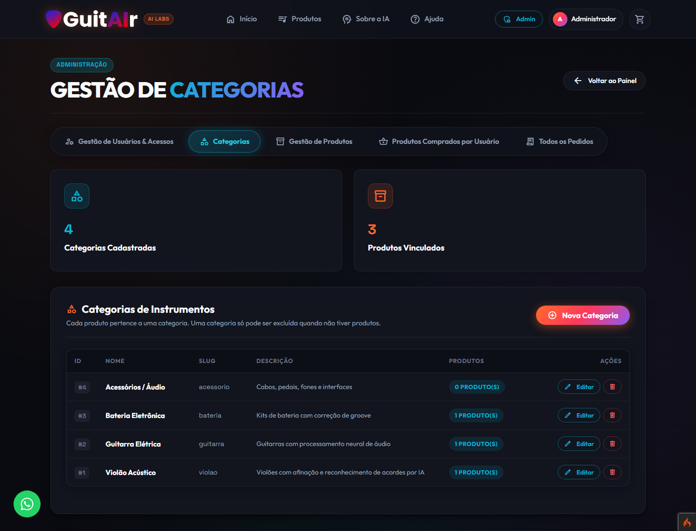
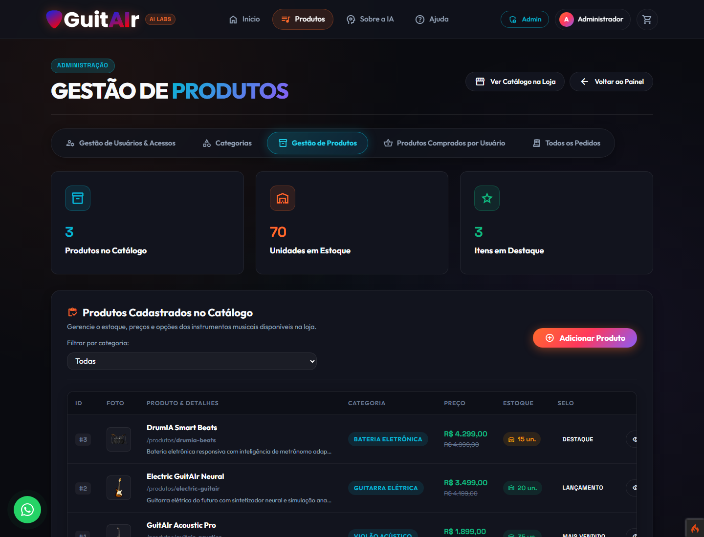
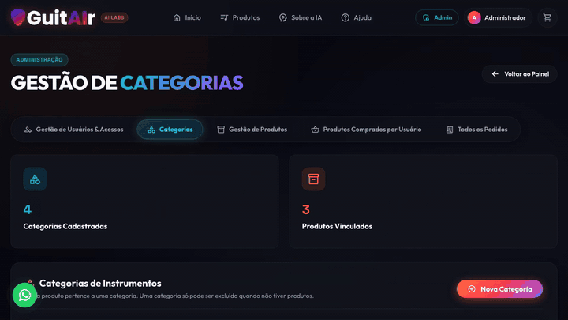

# 🎸 GuitAIr: loja de instrumentos musicais com IA

O GuitAIr é uma startup fictícia (projeto integrador) que vende instrumentos musicais "inteligentes": violões, guitarras e baterias com IA embarcada.
Este repositório tem a **loja online** completa e um **painel administrativo**. Ele foi feito em **PHP orientado a objetos**, com o padrão **MVC** e acesso a dados no padrão **DAO**, sobre um banco **MySQL**.

> **Relacionamento principal do trabalho:** `categories` (1) ──< (N) `products`.
> Cada produto pertence a uma categoria, e as **duas tabelas têm CRUD completo** no painel administrativo.

---

## 📸 Screenshots

| Loja: página inicial | Catálogo com filtro por categoria |
|---|---|
|  |  |

| Admin: CRUD de Categorias | Admin: CRUD de Produtos |
|---|---|
|  |  |

<!-- TODO: gravar um GIF do CRUD e salvar em docs/screenshots/crud.gif -->


---

## 👤 Autor

Projeto individual.

| Nome completo | R.A. |
|---|---|
| Igor Gutock Martins | igor.9946 |

---

## 🛠️ Tecnologias e bibliotecas

| Camada | Tecnologia |
|---|---|
| Linguagem | PHP 8.2+ (orientado a objetos) |
| Framework | CodeIgniter 4.7 (MVC) |
| Banco de dados | MySQL 8 / MariaDB |
| Acesso a dados | Models do CodeIgniter usados como DAO (Query Builder + transações) |
| Front-end | HTML5, CSS3, JavaScript puro, Google Material Symbols |
| Dependências | Composer |
| Ambiente | Docker + Docker Compose (`php:8.2-apache`, `mysql:8.0`, phpMyAdmin) |
| Testes | PHPUnit 10 |

---

## 🧱 Arquitetura (MVC + DAO)

```
app/
├── Controllers/        ← CONTROLLER: recebe a requisição, valida e chama o Model
│   ├── Admin.php           (CRUD de categorias, produtos, pedidos e usuários)
│   ├── Products.php        (catálogo da loja)
│   ├── Cart.php / Buy.php  (carrinho e checkout)
│   └── Account.php / Reviews.php ...
├── Models/             ← MODEL: entidades + DAO (todo o SQL fica aqui)
│   ├── CategoryModel.php   (tabela categories: pai)
│   ├── ProductModel.php    (tabela products: filha, FK category_id)
│   ├── OrderModel.php      (pedidos, com transação)
│   ├── UserModel.php, CouponModel.php, ReviewModel.php
├── Views/              ← VIEW: telas HTML
│   ├── admin/categories.php  (CRUD de categorias)
│   ├── admin/products.php    (CRUD de produtos)
│   └── home.php, products.php, cart.php, buy.php ...
└── Config/Routes.php   ← rotas (URL → Controller::método)
schema.sql              ← script completo do banco
```

* **Model / DAO:** cada classe em `app/Models` representa uma tabela e concentra **todo** o acesso ao banco.
  São métodos como `createCategory()`, `updateCategory()`, `deleteCategory()`, `listWithProductCount()`, `adminList()`, `createProduct()`, `removeProduct()` e `createOrder()`.
  Os controllers **não escrevem SQL**.
* **Controller:** lê o formulário, aplica as regras de negócio (por exemplo: categoria com produtos não pode ser excluída, preço precisa ser maior que zero), chama o DAO e escolhe a View.
* **View:** só exibe os dados recebidos do controller.

### Regras do relacionamento Categoria → Produto
* `products.category_id` é chave estrangeira para `categories.id` (`ON DELETE RESTRICT`).
* Uma categoria **só pode ser excluída se não tiver produtos**. O sistema avisa quantos produtos estão vinculados.
* Ao excluir um produto **nunca vendido**, ele é apagado do banco (DELETE).
  Um produto que **já aparece em pedidos** é só desativado (`active = 0`), para não perder o histórico de vendas.
* No painel, cada categoria mostra quantos produtos tem, com um link para a lista filtrada.
  As abas de categoria da loja também vêm do banco.

---

## 🗄️ Banco de dados

O arquivo [`schema.sql`](schema.sql) cria o banco `guitair_db` com todas as tabelas, chaves estrangeiras e dados iniciais:

| Tabela | Descrição |
|---|---|
| **categories** | Categorias de instrumentos (**pai**) |
| **products** | Produtos, com `category_id` (**filha**) |
| users | Clientes e administradores |
| orders / order_items | Pedidos e itens do pedido |
| coupons | Cupons de desconto (`GUITAIR10`, `IA2026`, `FRETEGRATIS`) |
| addresses | Endereços salvos dos usuários |
| reviews | Avaliações (1 por usuário/produto) |
| campaign_leads | Leads da campanha Maio Laranja |

**Usuários de teste criados pelo script:**

| Perfil | E-mail | Senha |
|---|---|---|
| Administrador | `admin@guitair.com` | `admin123` |
| Cliente | `cliente@guitair.com` | `cliente123` |

---

## 🚀 Instalação e execução (passo a passo)

Há duas formas de rodar. A **Opção 1 (Docker)** é a recomendada: um comando sobe a loja, o banco e o phpMyAdmin, sem instalar PHP nem MySQL.

### Opção 1: Docker (recomendada)

**Pré-requisito:** [Docker Desktop](https://www.docker.com/products/docker-desktop/) instalado e aberto.

1. Clone o repositório:
   ```bash
   git clone https://github.com/ig0moon/startupGuitair.git
   cd startupGuitair
   ```
2. Suba tudo:
   ```bash
   docker compose up -d --build
   ```
   Na primeira vez demora alguns minutos (baixa as imagens e instala as dependências). O banco é criado automaticamente a partir do `schema.sql`.
3. Acesse:

   | O quê | Endereço |
   |---|---|
   | Loja + painel admin | **http://localhost:8090** |
   | phpMyAdmin (ver as tabelas) | http://localhost:8081 |
   | MySQL (HeidiSQL, DBeaver…) | `127.0.0.1`, porta `3308`, usuário `root`, senha `guitair` |

4. Entre com `admin@guitair.com` / `admin123` e vá em **Admin → Categorias** e **Admin → Gestão de Produtos**.

Comandos úteis:
```bash
docker compose down        # para tudo (os dados continuam salvos)
docker compose down -v     # para e apaga os dados; na próxima subida o banco é recriado do zero
```

### Opção 2: PHP + MySQL instalados (XAMPP, Laragon ou similares)

**Pré-requisitos:** PHP **8.2+** (extensões `intl`, `mbstring` e `mysqli`), [Composer](https://getcomposer.org/) e MySQL 8 ou MariaDB.

1. Clone o repositório e instale as dependências:
   ```bash
   git clone https://github.com/ig0moon/startupGuitair.git
   cd startupGuitair
   composer install
   ```
2. Crie o banco rodando o `schema.sql`. Ele cria o banco `guitair_db`, as tabelas e os dados de exemplo:
   ```bash
   mysql -u root -p < schema.sql
   ```
   No PowerShell, use `mysql -u root -p -e "source schema.sql"`. Também dá para abrir o arquivo no phpMyAdmin ou no HeidiSQL e executar tudo.
3. Crie o `.env` a partir do modelo e ajuste os dados do seu MySQL:
   ```bash
   cp env .env
   ```
   ```ini
   CI_ENVIRONMENT = development
   app.baseURL = 'http://localhost:8080/'

   database.default.hostname = localhost
   database.default.database = guitair_db
   database.default.username = root
   database.default.password = SUA_SENHA
   database.default.DBDriver = MySQLi
   database.default.port = 3306
   ```
4. Rode o servidor:
   ```bash
   php spark serve
   ```
   Acesse **http://localhost:8080** e entre com `admin@guitair.com` / `admin123`.

---

## 🔁 Onde está o CRUD

| Operação | Categorias (`/admin/categorias`) | Produtos (`/admin/produtos`) |
|---|---|---|
| **Create** | Botão "Nova Categoria" → `POST admin/categorias/salvar` | Botão "Adicionar Produto" (escolhe a categoria) → `POST admin/produtos/salvar` |
| **Read** | Tabela com nº de produtos por categoria | Tabela com JOIN na categoria + filtro por categoria |
| **Update** | "Editar" → `POST admin/categorias/atualizar` | "Editar" (pode trocar a categoria) → `POST admin/produtos/atualizar` |
| **Delete** | Lixeira → `POST admin/categorias/excluir` (bloqueia se houver produtos) | Lixeira → `POST admin/produtos/excluir` |

Além disso, o sistema tem carrinho, cupons, checkout com transação e baixa de estoque, avaliações, gestão de pedidos e gestão de papéis de usuário.

---

## 🤖 Transparência de IA

O autor usou ferramentas de IA (Claude / Claude Code) como apoio no desenvolvimento:

* **Estrutura do DAO:** a IA ajudou a mover as consultas SQL que estavam no controller `Admin` para os Models (`CategoryModel`, `ProductModel`, `OrderModel` e `UserModel`), separando o acesso a dados das regras de negócio.
* **CRUD de categorias:** a IA gerou a primeira versão do `CategoryModel`, da tela `admin/categories.php` e das rotas. O autor revisou e testou o código.
* **Script do banco:** a IA ajudou a montar o `schema.sql` completo, com chaves estrangeiras e dados iniciais.
* **Refatoração e tratamento de erros:** a IA sugeriu o checkout com transação, as mensagens de erro e as validações.
* **Documentação:** a IA ajudou na escrita deste README.

**Feito pelo autor:** a ideia da startup GuitAIr, a identidade visual, as telas da loja, o fluxo de compra, as regras de negócio (cupons, frete, estoque, avaliações), os testes manuais e a gravação do vídeo.

---

## 🎬 Vídeo
Roteiro do vídeo de apresentação: [`docs/ROTEIRO_VIDEO.md`](docs/ROTEIRO_VIDEO.md)

<!-- TODO: colar aqui o link do vídeo no YouTube -->

---

## 📄 Licença
MIT. Veja [LICENSE](LICENSE).
